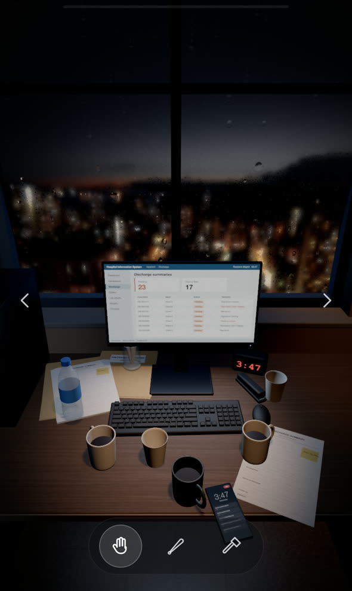
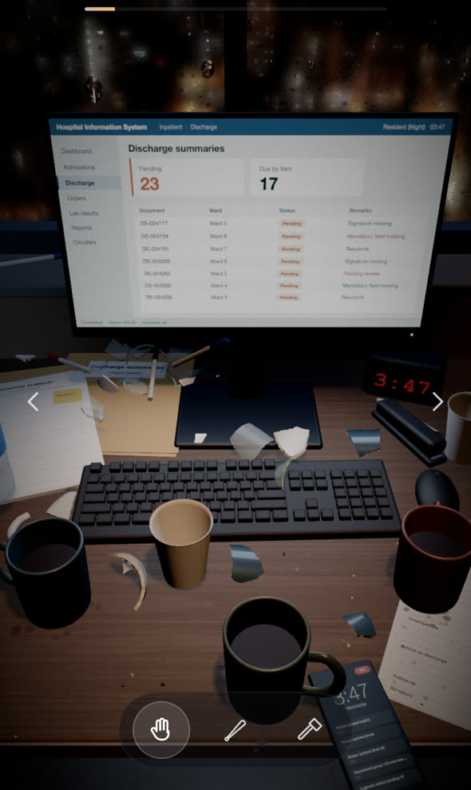
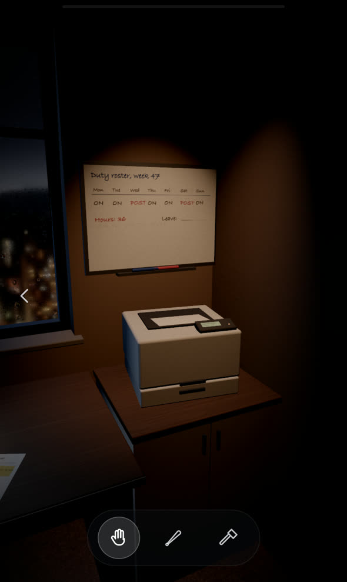
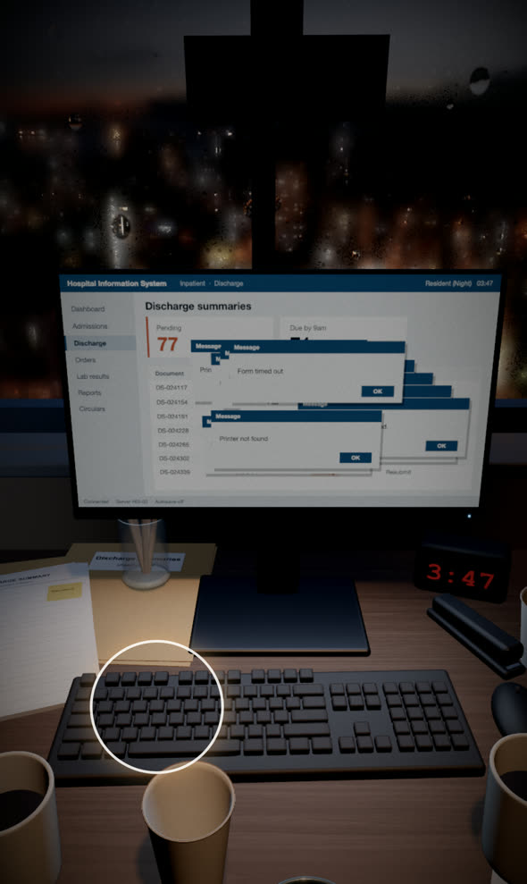
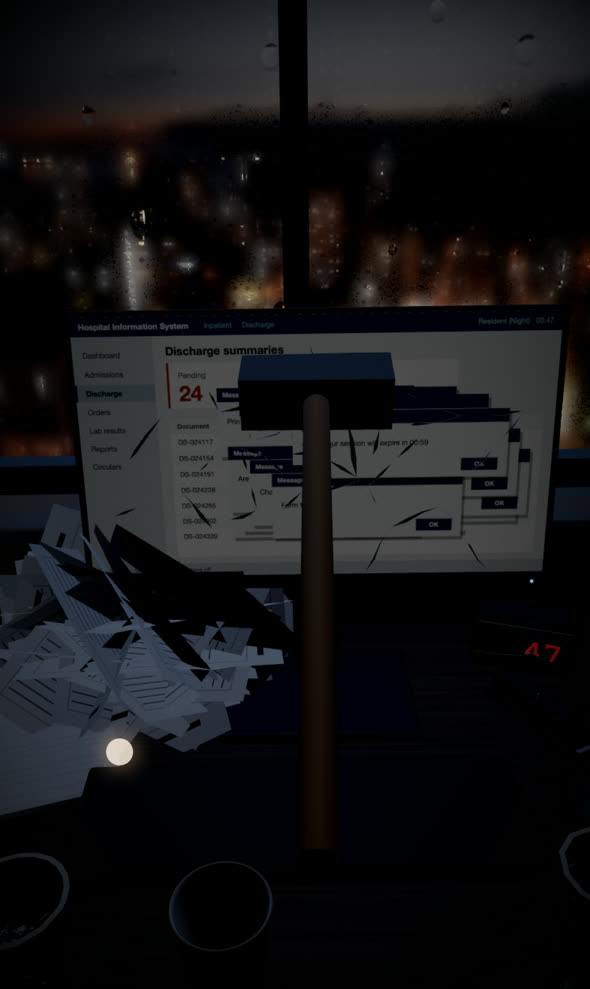
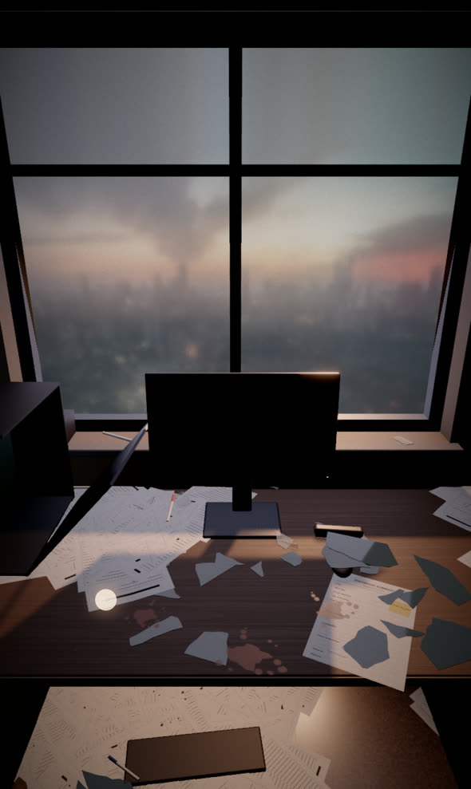
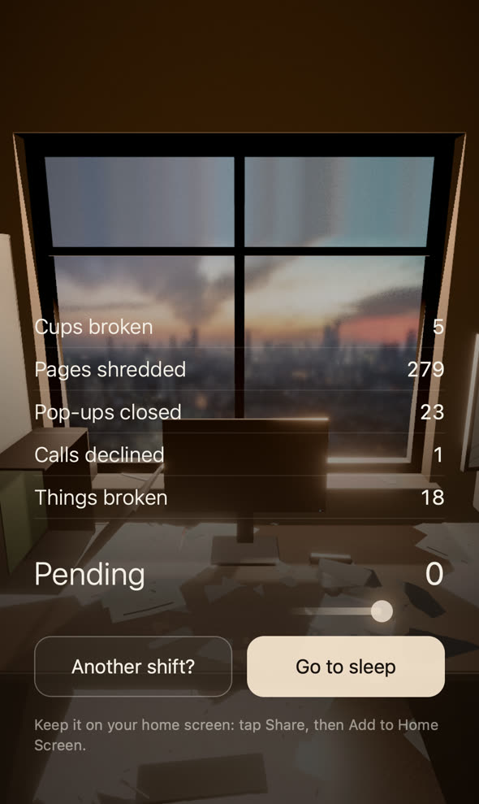

# Night Duty

A short destruction game for phones. It's 3 a.m. in a hospital duty room, the pager won't stop, and there's a desk full of things you're allowed to break.

**Play:** https://nightduty.saahitya-e.workers.dev

Best on a recent phone in portrait. Add it to the home screen to play offline.

<table>
  <tr>
    <td></td>
    <td></td>
    <td></td>
  </tr>
  <tr>
    <td align="center">3:47 a.m.</td>
    <td align="center">Cups</td>
    <td align="center">The printer</td>
  </tr>
  <tr>
    <td></td>
    <td></td>
    <td></td>
  </tr>
  <tr>
    <td align="center">Pop-ups</td>
    <td align="center">The hammer</td>
    <td align="center">Dawn</td>
  </tr>
</table>

<p align="center"></p>

## Stack

- [Three.js](https://threejs.org/) (WebGL2) for rendering, [Rapier](https://rapier.rs/) for physics, built with Vite and TypeScript
- Headless Blender scripts in `tools/blender/` for modelling, fracture and light baking
- Playwright tests in WebKit (iPhone 15 Pro) and Chrome (Pixel 7)
- Static hosting on a Cloudflare Worker

## Run locally

```sh
npm install
npm run dev        # dev server on the LAN, port 5173
npm test           # Playwright, screenshots in test-results/screens/
npm run build      # production build in dist/
```

`?all=1` unlocks every tool and view. `?shot=desk|deskWide|left|right|finale|dawn` jumps to a view.

## Credits

All sound and music is CC0, from Freesound. See [CREDITS.md](CREDITS.md).
